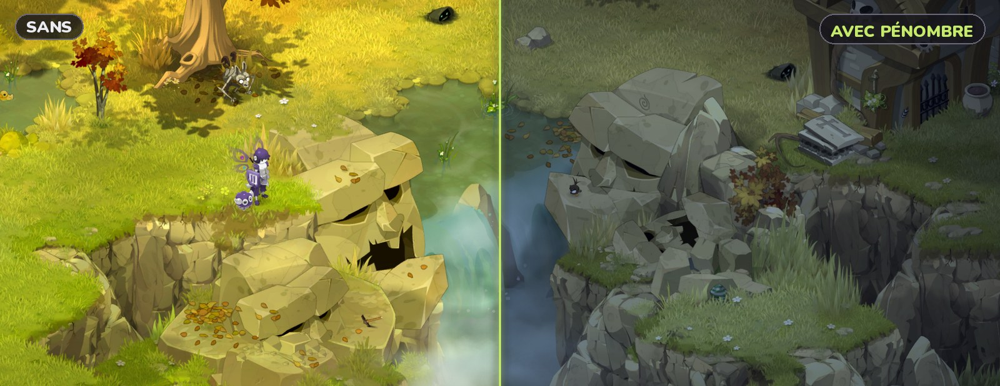
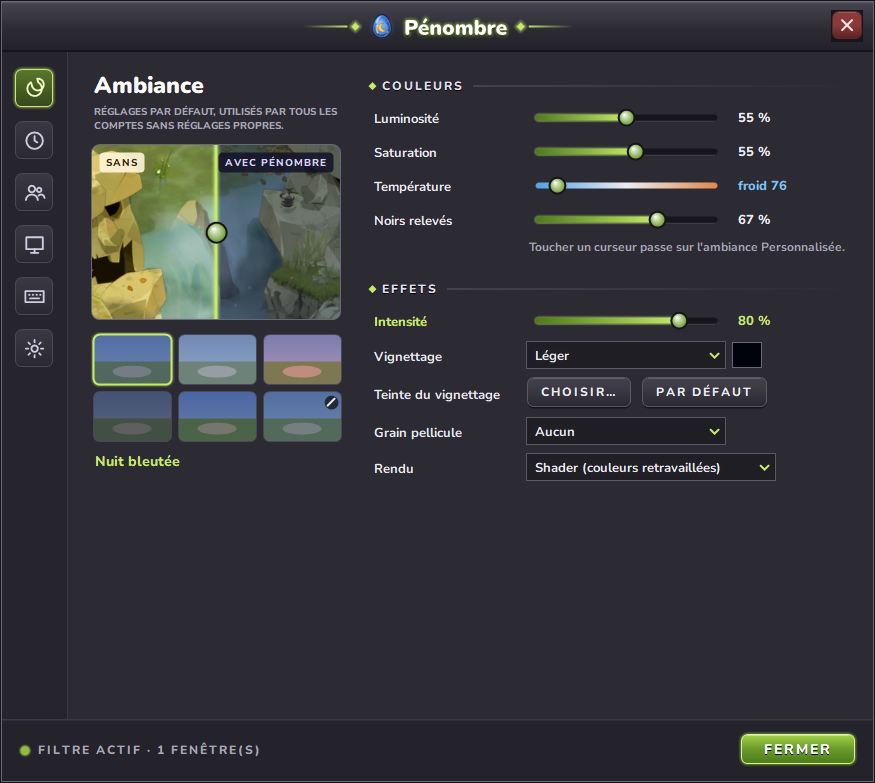
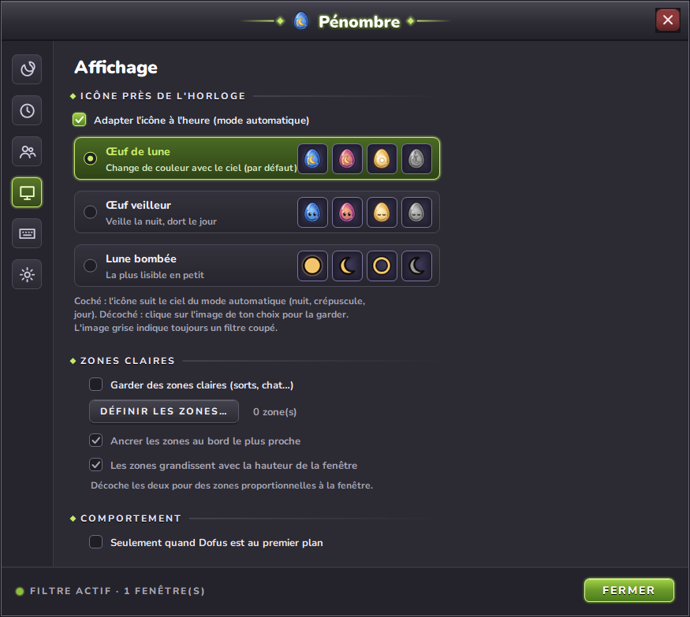
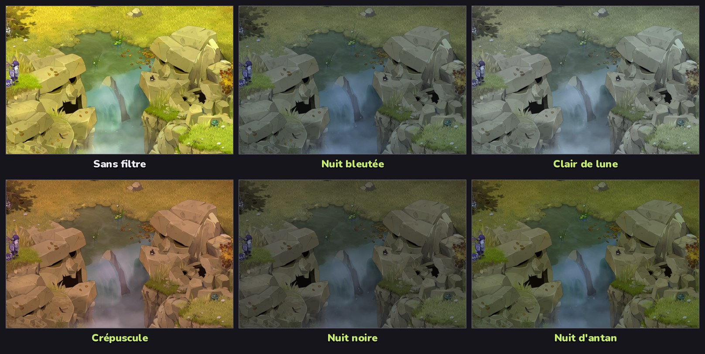

  

<h1 align="center">Pénombre</h1>

  Un <b>modo noche</b> para Dofus 3, como el de Dofus 1.29. 
  Un pequeño <code>.exe</code>, nada que instalar. Windows 10 y 11 (64 bits).

  
  
  

  <a href="https://github.com/Sokenzane/Penombre/releases/latest/download/Penombre.exe"><b>Descargar Penombre.exe</b></a>

  <a href="README.md">Français</a> · <a href="README.en.md">English</a> · <b>Español</b>

  

## Índice

- [¿Qué es?](#qué-es)
- [¿Es seguro para mi cuenta?](#es-seguro-para-mi-cuenta)
- [Descarga](#descarga)
- [Uso](#uso)
  - [Atajos](#atajos)
  - [Ventana de ajustes](#ventana-de-ajustes)
  - [Ambientes](#ambientes)
  - [Modo automático](#modo-automático)
  - [Zonas claras](#zonas-claras)
  - [Varias cuentas](#varias-cuentas)
  - [Icono del área de notificación](#icono-del-área-de-notificación)
  - [Modo portátil y copia de seguridad](#modo-portátil-y-copia-de-seguridad)
  - [Actualizaciones](#actualizaciones)
- [Funcionamiento](#funcionamiento)
  - [Renderizados](#renderizados)
  - [Multicuenta](#multicuenta)
  - [Rendimiento](#rendimiento)
- [Archivos](#archivos)
- [Diagnóstico y registro](#diagnóstico-y-registro)
- [Límites conocidos](#límites-conocidos)
- [Compilarlo uno mismo](#compilarlo-uno-mismo)
- [Contribuir](#contribuir)
- [Licencia](#licencia)

## ¿Qué es?

Dofus 1.29 podía pasar el juego a modo noche; Dofus 3 no. Pénombre coloca sobre la zona de juego un filtro que deja pasar los clics, la oscurece, enfría los colores y eleva un poco los negros, para un ambiente nocturno:

- **Verdadero trabajo del color** (shader): cada píxel se recalcula a través de una matriz de color, en lugar de taparlo con una capa oscura.
- **Ambientes**: noche azulada, claro de luna, atardecer, noche cerrada, noche de antaño, o el tuyo.
- **Sigue la hora real** si quieres, con horarios fijos o la **puesta y salida reales del sol** de tu ciudad, y transiciones suaves.
- **Preparado para multicuenta**: un filtro por ventana de Dofus, sin oscurecimiento acumulado, y **ajustes por cuenta**.
- **Zonas claras**: la barra de hechizos o el chat siguen legibles.
- **Vistazo**: mantén un atajo para ver el juego sin filtro.
- **Viñeta** (del tono que quieras) y **grano de película** opcionales.

## ¿Es seguro para mi cuenta?

Pénombre **nunca toca el cliente de Dofus**: ni inyección, ni lectura de memoria, no se envía nada al juego ni a sus servidores. El filtro es una ventana de Windows aparte, colocada sobre el juego, como un tinte de pantalla (f.lux, la luz nocturna de Windows…). Solo usa funciones públicas de Windows para encontrar las ventanas del juego y dibujar encima. Su única conexión a Internet es la [búsqueda de actualizaciones](#actualizaciones), hacia GitHub.

Ankama no ha revisado ni aprobado Pénombre. Lee tú mismo las condiciones de uso del juego y úsalo bajo tu responsabilidad.

## Descarga

**[Descarga Penombre.exe](https://github.com/Sokenzane/Penombre/releases/latest/download/Penombre.exe)** y ábrelo. Sin instalación ni derechos de administrador. Para llevarlo en una memoria USB o a varios PC, marca el [modo portátil](#modo-portátil-y-copia-de-seguridad). Las notas de versión y las versiones anteriores están en la página [Releases](https://github.com/Sokenzane/Penombre/releases), con el SHA-256 de cada exe (ver [SECURITY.md](SECURITY.md#vérifier-un-téléchargement)). Necesita .NET Framework 4, incluido en todos los Windows 10 y 11.

> El exe no está firmado: Windows SmartScreen puede mostrar *«Windows protegió su PC»*. Haz clic en **Más información** y luego en **Ejecutar de todas formas**. También puedes [compilarlo tú mismo](#compilarlo-uno-mismo) con un clic.

Dofus debe estar en modo **ventana** o **pantalla completa en ventana**: en pantalla completa exclusiva, ninguna ventana puede mostrarse sobre el juego.

## Uso

Abre `Penombre.exe`: aparece un huevo lunar en el área de notificación (junto al reloj, a veces oculto tras la flecha `^`). Clic izquierdo para activar o desactivar el filtro, clic derecho para el menú. **Pausa** (en el menú) desactiva el filtro durante 15 min, 30 min, 1 h o 2 h y luego lo vuelve a poner solo; `Ctrl+Alt+N` o «Reanudar ahora» lo vuelven a poner antes. Abrir `Penombre.exe` otra vez mientras funciona abre la ventana de ajustes.

### Atajos

| Atajo por defecto | Acción |
| --- | --- |
| `Ctrl+Alt+N` | Activar / desactivar el filtro (con fundido) |
| `Ctrl+Alt+C` | **Vistazo**: mantenlo para ver el juego sin filtro |
| `Ctrl+Alt+A` | Activar / desactivar el modo automático |
| `Ctrl+Alt+P` | Ambiente siguiente |
| `Ctrl+Alt+RePág` / `AvPág` | Intensidad +5 % / -5 % |
| `Ctrl+Alt+V` | Viñeta siguiente (ninguna, ligera, media, fuerte) |

Cada atajo se cambia en **Ajustes… > Atajos** (haz clic en una casilla y pulsa la nueva combinación; `Retroceso` lo borra). Un atajo ya usado por otra aplicación se marca como *no disponible*. Cuando el Dofus en primer plano tiene [ajustes propios](#varias-cuentas), los atajos de ambiente, intensidad y viñeta cambian esos.

### Ventana de ajustes

Menú **Ajustes…**. La ventana sigue el espíritu de la interfaz de Dofus 3: secciones a la izquierda, controles deslizantes y botones verdes. Todo se aplica en directo, con una transición suave:

  
  

Las capturas muestran la interfaz en francés; en un Windows en español, Pénombre se muestra en español.

| Sección | Contenido |
| --- | --- |
| Ambiente | vista previa en directo (una parte del juego sin y con el filtro), muestras de ambientes, controles del ambiente personalizado, intensidad, viñeta y su tono, grano de película, renderizado |
| Horarios | modo automático (horarios fijos o sol real), tono de atardecer, duración de las transiciones (0 a 2 s) |
| Cuentas | ajustes por cuenta |
| Visualización | icono del área de notificación, zonas claras, «solo cuando Dofus está en primer plano» |
| Atajos | todos los atajos, personalizables |
| General | inicio con Windows, modo portátil, actualizaciones, carpeta de ajustes, exportar / importar, restablecer, registro |

### Ambientes

La intensidad (5 a 100 %) dosifica el efecto entre la imagen original y el ambiente completo.

  

| Ambiente | Brillo | Saturación | Tono |
| --- | --- | --- | --- |
| Noche azulada | 55 % | 55 % | azul frío |
| Claro de luna | 70 % | 30 % | azul pálido, negros elevados |
| Atardecer | 72 % | 80 % | violeta cálido |
| Noche cerrada | 38 % | 50 % | azul ligero |
| Noche de antaño | 62 % | 90 % | azul, al estilo 1.29 |
| Personalizado | ajustable | ajustable | frío ↔ cálido, negros elevados |

Mover un control deslizante en los ajustes crea un ambiente **Personalizado** a partir del actual.

### Modo automático

El filtro sigue la hora de tu PC, con dos maneras de fijar los horarios:

- **Horarios fijos** (abajo);
- **Puesta y salida reales del sol**: elige tu ciudad (o escribe coordenadas). La noche cae 45 min antes de la puesta y es completa 45 min después; el alba funciona igual alrededor de la salida. Se calcula sin conexión, y los horarios siguen las estaciones.

| Momento | Por defecto | Filtro |
| --- | --- | --- |
| Inicio del atardecer | 19:30 | sube poco a poco |
| Noche completa | 21:30 | efecto completo |
| Inicio del alba | 06:30 | baja poco a poco |
| Día completo | 08:30 | ninguno (shader en pausa) |

**Tono de atardecer** (sección Horarios, activado por defecto): mientras cae la noche y mientras amanece, el filtro toma los colores cálidos del ambiente Atardecer, al máximo a mitad de camino, y luego vuelve a tu ambiente de noche. Es el efecto «cae la noche» de Dofus 1.29.

### Zonas claras

Para mantener legibles la barra de hechizos, el chat o la línea de tiempo: **Ajustes… > Visualización > Definir las zonas…**. Aparece una capa sobre la ventana de Dofus: arrastra para dibujar una zona, clic derecho sobre una zona para borrarla, `Supr` para borrarlo todo, `Intro` para guardar, `Esc` para cancelar. Las zonas valen para todas las cuentas. Por defecto están **ancladas al borde más cercano** (una barra de hechizos abajo se queda abajo) y **crecen con la altura de la ventana**, como la interfaz de Dofus; desmarca ambas opciones en **Visualización** para zonas proporcionales a la ventana.

### Varias cuentas

Cada personaje puede filtrarse o no, desde el menú **Cuentas** o los ajustes. En **Ajustes… > Cuentas**, un personaje también puede tener **su propio ambiente, intensidad y viñeta** en lugar de los de por defecto: basta con cambiar uno de los tres para activar sus ajustes propios. Los personajes se reconocen por el título de su ventana, y sus ajustes se guardan aunque no estén abiertos.

Opción **Solo cuando Dofus está en primer plano** (sección Visualización): el filtro solo aparece en la ventana de Dofus en la que juegas.

### Icono del área de notificación

Tres estilos a elegir en **Ajustes… > Visualización**. Con **Adaptar el icono a la hora** marcado (por defecto), el icono sigue el cielo según los horarios del [modo automático](#modo-automático): noche, atardecer o alba, día. Lo hace aunque el modo automático esté desactivado: el icono muestra la hora que es, el filtro mantiene su fuerza. Desmarcado, haz clic en la imagen que quieras (noche, atardecer o día) para conservarla. En todos los casos, la imagen gris indica un filtro desactivado.

| Estilo | Noche | Atardecer | Día | Desactivado |
| --- | --- | --- | --- | --- |
| **Huevo lunar** (por defecto) | huevo zafiro, luna dorada | huevo rosa y ámbar | huevo ámbar, sol | huevo de piedra agrietado |
| **Huevo vigía** | ojos abiertos | ojos abiertos | dormido | gris, dormido |
| **Luna redonda** | luna llena | creciente | contorno | creciente gris |

### Modo portátil y copia de seguridad

- **Modo portátil** (sección General): los ajustes y el registro pasan a una carpeta `Penombre-data` junto al exe. Si esa carpeta existe al iniciar, Pénombre la usa directamente. Copia la carpeta con el exe a otro PC y todo te sigue, zonas incluidas. Desmárcalo para devolverlos a `%APPDATA%`.
- **Exportar… / Importar…**: guarda tus ajustes en un archivo, o carga un archivo guardado en otro PC.
- **Buscar actualizaciones**: ver [Actualizaciones](#actualizaciones).
- **Restablecer los ajustes…**: lo deja todo como en el primer inicio (tras una confirmación). El registro, la carpeta de ajustes y el inicio con Windows no cambian.

### Actualizaciones

Al iniciar, y luego una vez al día, Pénombre pregunta a GitHub cuál es la última versión publicada. Si es más reciente, un globo lo avisa y aparece una línea **Nueva versión disponible…** arriba del menú: un clic abre la página de descarga. No se descarga ni se instala nada solo. GitHub solo ve tu dirección IP, como con cualquier página web. Desmarca **Buscar actualizaciones** (sección General) para no conectarte nunca; el botón **Buscar ahora** sigue disponible.

## Funcionamiento

Las ventanas de Dofus 3 se detectan automáticamente (clase de ventana `UnityWndClass` en un proceso `Dofus`).

### Renderizados

- **Shader** (por defecto): la API Magnification de Windows redibuja la zona de juego a través de una matriz de color 5×5. El brillo se multiplica, los colores se desaturan y se tiñen, los negros se elevan. Es el mismo principio que el `ColorTransform` de Flash de la noche de Dofus 1.29.
- **Velo**: una simple capa de color semitransparente, como alternativa si el shader no está disponible.
- **Viñeta** (opcional, con los dos renderizados): bordes y esquinas oscurecidos, centro despejado, dibujada con alfa por píxel.

### Multicuenta

Cada filtro se recorta (`SetWindowRgn`) a la parte **realmente visible** de su ventana de Dofus. Pénombre recorre las ventanas de arriba abajo en la pila de Windows: todo lo que está encima de una ventana de Dofus (otra aplicación, otro cliente) oculta la parte cubierta. Dos filtros nunca se superponen, y el oscurecimiento no se acumula al cambiar de cuenta.

Las ventanas que dejan pasar los clics (superposiciones de GPU, Discord, Steam…), invisibles, ocultas (otros escritorios virtuales) o muy finas (pestañas de herramientas que agrupan ventanas) no cuentan como obstáculos.

### Rendimiento

- Pénombre reacciona a los eventos de Windows (ventana movida, mostrada, ocultada, traída al frente…) en lugar de revisarlo todo en bucle. Una comprobación de seguridad se hace cada 500 ms.
- Shader: unas 30 imágenes por segundo para el Dofus en primer plano (el ritmo de la API Magnification de Windows), unas 7 para los de segundo plano.
- El shader se pausa cuando Dofus está minimizado o totalmente oculto, cuando el filtro está desactivado, o en pleno día (modo automático). El programa pasa entonces a reposo (10 comprobaciones por segundo).

## Archivos

En `%APPDATA%\Penombre\` (o `Penombre-data` junto al exe en [modo portátil](#modo-portátil-y-copia-de-seguridad)):

- `settings.ini`: todos los ajustes, incluidos los de cada cuenta y los atajos. Si tu cliente no se llama `Dofus.exe`, cambia la línea `process=`. Para volver a empezar: **Restablecer los ajustes…** (sección General), o borra el archivo.
- `penombre.log`: el registro (inicio, ventanas detectadas, errores). Pasados 512 KB, se renombra a `penombre.log.old`.

La interfaz sigue el idioma de Windows (francés, inglés o español). Para elegir otro, haz clic en el pequeño botón de idioma (`ES ▾`) arriba a la izquierda de la ventana de ajustes; `--lang=fr`, `--lang=en` o `--lang=es` lo fuerza al iniciar. El inicio con Windows escribe un único valor en `HKCU\Software\Microsoft\Windows\CurrentVersion\Run`; no se escribe nada más en tu sistema.

## Diagnóstico y registro

- **Copiar el diagnóstico**: copia el estado completo al portapapeles (versión de Windows, ventanas de Dofus, filtros, modo automático, zonas, cuentas, pila de ventanas de Windows). Contiene los títulos de tus ventanas, es decir, los nombres de tus personajes: ocúltalos antes de publicarlo si lo prefieres.
- **Abrir el registro**: abre `penombre.log` en el Bloc de notas.

## Límites conocidos

- La pantalla completa exclusiva no es compatible (ver [Descarga](#descarga)).
- La interfaz del juego también se oscurece, salvo si defines [zonas claras](#zonas-claras). Si se desplazan tras cambiar el tamaño, prueba las otras opciones de zonas o vuelve a dibujarlas.
- El shader es una transformación de color por píxel (matriz), no un shader de GPU programable: sin desenfoque, bloom ni luz localizada.
- Con el renderizado shader, la imagen filtrada puede ir un fotograma por detrás del juego.
- El grano de película usa unos 25 MB de memoria por ventana de Dofus, y tarda una fracción de segundo en prepararse al activarlo o cambiar el tamaño.
- Los horarios del sol suponen que la zona horaria del PC es la de la ciudad elegida.

## Compilarlo uno mismo

El código está en [`src/Penombre.cs`](src/Penombre.cs) y la interfaz en [`src/Interface.cs`](src/Interface.cs) (C# 5, WinForms, sin dependencias).

1. Clona o descarga el repositorio.
2. Haz doble clic en **`build.bat`**: usa el compilador de C# incluido en Windows.
3. Abre `dist\Penombre.exe`.

Los iconos y el logo se generan con `python tools/make_icon.py` (necesita Pillow y Playwright).

## Contribuir

Los informes de errores, las ideas y las pull requests son bienvenidos. Ver [CONTRIBUTING.md](CONTRIBUTING.md) (en francés).

## Licencia

Pénombre es software libre, publicado bajo la [Licencia Pública General de GNU v3.0](LICENSE).
Puedes usarlo, estudiarlo, compartirlo y modificarlo; las versiones modificadas que distribuyas deben seguir siendo de código abierto bajo la misma licencia y citar el proyecto original.

Copyright © 2026 [Sokenzane](https://github.com/Sokenzane).

La fuente [Nunito](https://github.com/googlefonts/nunito) (© The Nunito Project Authors), integrada en el exe, está bajo la [licencia SIL Open Font 1.1](assets/fonts/OFL.txt).

Pénombre es un proyecto de fans independiente, sin afiliación con Ankama ni aprobado por Ankama. Dofus es una marca de Ankama. Este repositorio no incluye ningún elemento del juego.
